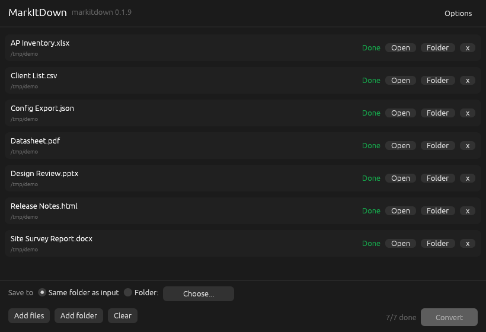
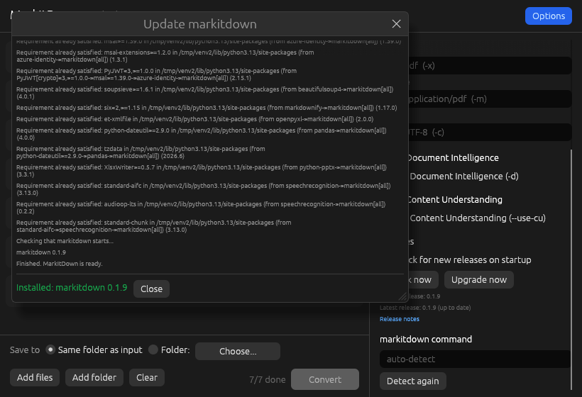
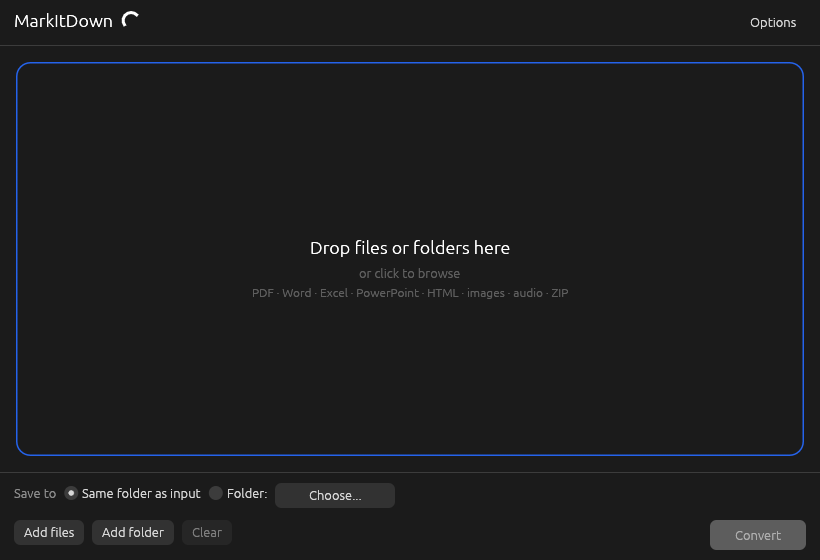
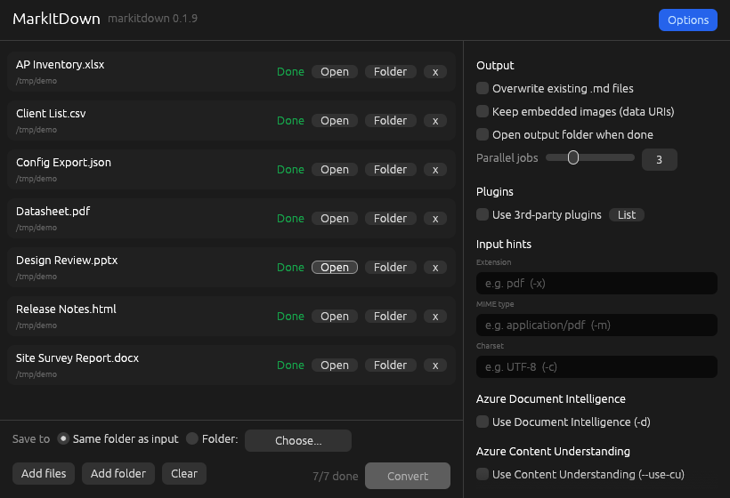
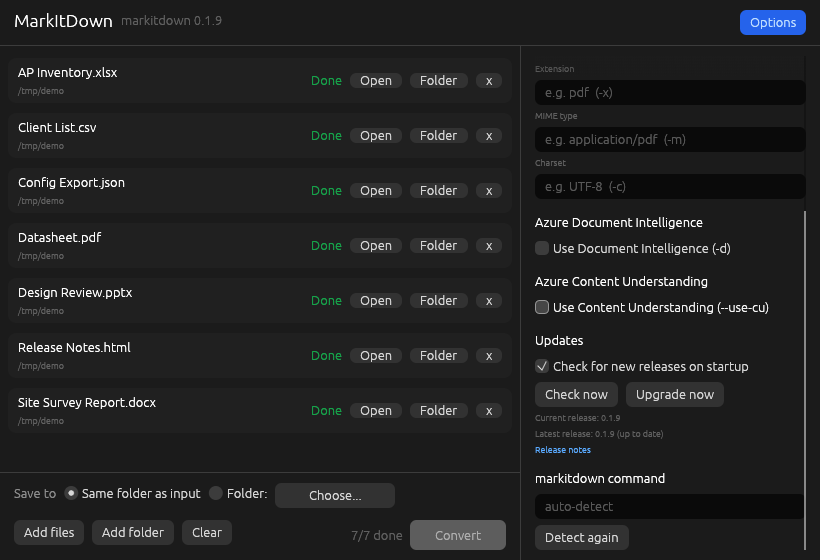

<p align="center">
  
</p>

<h1 align="center">MarkItDown GUI</h1>

<p align="center">
  A small, portable Windows app for converting documents to Markdown with
  <a href="https://github.com/microsoft/markitdown">Microsoft MarkItDown</a>.<br>
  Drag files in, click Convert, get clean <code>.md</code> files. No installer, no command line.
</p>

<p align="center">
  <a href="https://github.com/mohdbushnaq/markitdown-gui/releases/latest"></a>
  
  
  <a href="LICENSE"></a>
</p>

<p align="center">
  
</p>

> **Unofficial project.** MarkItDown GUI is an independent front-end. It is not made by or affiliated with Microsoft.
> All document conversion is done by the official, unmodified MarkItDown.

## Contents

- [Download](#download)
- [First run](#first-run)
- [How to use](#how-to-use)
- [Features](#features)
- [Options](#options)
- [Updating MarkItDown](#updating-markitdown)
- [Supported formats](#supported-formats)
- [Where files are stored](#where-files-are-stored)
- [Troubleshooting](#troubleshooting)
- [Build from source](#build-from-source)
- [Credits](#credits)

## Download

1. Open the [latest release](https://github.com/mohdbushnaq/markitdown-gui/releases/latest).
2. Download **`MarkItDown GUI.exe`** (about 7 MB).
3. Put it in any folder you like and double-click it.

That's the whole install. The app is a single portable `.exe` that runs on any 64-bit Windows 10 or 11 PC
without extra DLLs or admin rights.

> Windows may show a SmartScreen warning the first time because the app is not code-signed.
> Click **More info**, then **Run anyway**.

## First run

On first launch the app sets everything up by itself. You do **not** need to install Python.

1. It looks for an existing MarkItDown on your PC.
2. If there is none, it downloads the official embeddable Python from python.org into a private
   `MarkItDown GUI runtime` folder next to the `.exe`.
3. It installs `markitdown[all]` into that private Python and checks that it starts.

Progress is shown in a log window. This takes a few minutes and about 500 MB of disk space, once.
Nothing is installed system-wide, nothing is added to PATH, and no admin rights are needed.

<p align="center">
  
</p>

## How to use

<p align="center">
  
</p>

1. **Add files.** Drag files or whole folders onto the window, click the drop zone, or use **Add files** / **Add folder**.
   You can also drop files onto the `.exe` itself.
2. **Choose where to save.** By default each `.md` is saved **next to its original file**.
   Pick **Folder:** to send everything to one folder instead.
3. **Click Convert.** Each file shows its status: Ready, Queued, a spinner while converting, then **Done** or the error.
4. **Open the result.** Use **Open** to open the Markdown file, or **Folder** to show it in File Explorer.
   Failed files have a **Retry** button, and hovering the error shows the full message.

Click **Stop** at any time to cancel. Running conversions are stopped immediately.

## Features

- Batch conversion with drag and drop of files and folders
- Saves next to each input file by default, or to a folder you choose
- Never overwrites existing files unless you allow it (uses `name (1).md` instead)
- Converts several files in parallel (1 to 8 at a time)
- Per-file Open, Show in folder, Retry and full error details
- Every MarkItDown command-line option is available as a setting (see below)
- Automatic first-run setup with a private Python runtime
- Checks for new MarkItDown releases and updates with one click
- Fully portable: settings and runtime live next to the `.exe`
- Remembers your settings between sessions
- Light on resources: a native Rust app (egui), about 7 MB

## Options

Click **Options** in the top-right corner.

<p align="center">
  
</p>

| Setting | What it does | MarkItDown flag |
|---|---|---|
| Overwrite existing .md files | Replace files with the same name instead of creating `name (1).md` | |
| Keep embedded images (data URIs) | Keep images inside the Markdown as base64 instead of placeholders | `--keep-data-uris` |
| Open output folder when done | Opens the folder in File Explorer after a batch finishes | |
| Parallel jobs | How many files convert at the same time | |
| Use 3rd-party plugins / List | Enable installed MarkItDown plugins and list them | `-p`, `--list-plugins` |
| Extension, MIME type, Charset | Hints for files with missing or wrong extensions | `-x`, `-m`, `-c` |
| Azure Document Intelligence | Higher quality conversion of PDFs and scans with Azure | `-d`, `-e` |
| Azure Content Understanding | Analyze documents, images, audio and video with Azure | `--use-cu`, `--cu-endpoint`, `--cu-analyzer`, `--cu-file-types` |
| Azure API key | Optional key for the Azure options. Never saved to disk | `AZURE_API_KEY` |
| markitdown command | Use a specific `markitdown.exe` or `python.exe` instead of auto-detect | |

## Updating MarkItDown

<p align="center">
  
</p>

- On startup the app checks the [latest MarkItDown release](https://github.com/microsoft/markitdown/releases)
  (PyPI is used as a fallback). Turn this off with **Check for new releases on startup**.
- When a newer version exists, an **Update to x.y.z** button appears next to the version in the title bar.
- **Options > Updates** shows the *Current release* and *Latest release*, with **Check now**, **Upgrade now**
  and a link to the release notes.

Updating runs `python -m pip install --upgrade "markitdown[all]"` for the Python that owns your MarkItDown and shows the output live.

## Supported formats

Anything MarkItDown supports, including:

PDF, Word (`.docx`), PowerPoint (`.pptx`), Excel (`.xlsx`, `.xls`), HTML, CSV, JSON, XML, EPUB, ZIP archives,
Outlook messages (`.msg`), images (EXIF metadata) and audio (speech transcription).

## Where files are stored

| What | Where |
|---|---|
| The app | Wherever you put `MarkItDown GUI.exe` |
| Settings | `MarkItDown GUI.settings.ron` next to the `.exe` |
| Private Python and MarkItDown | `MarkItDown GUI runtime\` next to the `.exe` |

If the `.exe` is in a folder you cannot write to (for example Program Files), settings and the runtime go to
`%LOCALAPPDATA%\MarkItDown GUI` instead.

To move the app to another PC without downloading again, copy the `.exe` together with the
`MarkItDown GUI runtime` folder. To remove it completely, delete the `.exe`, the settings file and the runtime folder.

## Troubleshooting

**Setup says it could not download Python.**
The PC needs internet access to python.org and pypi.org on first run. Check proxies or firewalls and press **Install** again.

**"A Windows runtime library is missing".**
Install the [Microsoft Visual C++ Redistributable (x64)](https://aka.ms/vs/17/release/vc_redist.x64.exe), then press **Install** again.

**I already have MarkItDown installed.**
The app finds it automatically on PATH, in pip's user Scripts folders, or via `python -m markitdown`.
You can also point **Options > markitdown command** at a specific `markitdown.exe` or `python.exe`.

**Images from Word files are missing.**
By default MarkItDown replaces images with placeholders. Turn on **Keep embedded images (data URIs)**.

## Build from source

Requirements: [Rust](https://rustup.rs) (stable).

```bat
git clone https://github.com/mohdbushnaq/markitdown-gui.git
cd markitdown-gui
build.bat
```

`build.bat` builds a release with the C runtime linked statically and writes `MarkItDown GUI.exe` next to it.
Every push to `main` is also built by GitHub Actions; the `.exe` is available under the run's artifacts.

### How it works

The app is written in Rust with [egui](https://github.com/emilk/egui). It does not contain any MarkItDown code.
It runs the `markitdown` command line in the background with no console window, one process per file,
and reads the result and any errors back into the interface.

| File | Purpose |
|---|---|
| `src/main.rs` | User interface, settings and conversion queue |
| `src/runner.rs` | Finding and running MarkItDown, parallel workers, cancellation |
| `src/update.rs` | Release checks, private Python setup and pip updates |

## Credits

- Conversion by [Microsoft MarkItDown](https://github.com/microsoft/markitdown) (MIT License).
- Interface built with [egui / eframe](https://github.com/emilk/egui) and [rfd](https://github.com/PolyMeilex/rfd).

Created by **[Mohammed Bushnaq](https://github.com/mohdbushnaq)**.

## License

[MIT](LICENSE) © 2026 Mohammed Bushnaq
